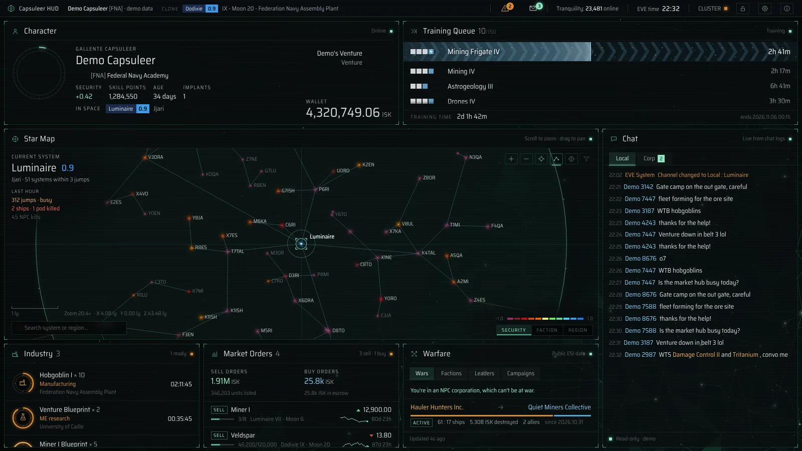

# EVE HUD

A live EVE Online HUD for a second screen, as a desktop app for Windows and macOS. It shows your character, skill training, industry, market orders, chat, a star map with routes and hazards, Faction Warfare and more, from CCP's ESI and EVE's own log files. Laid out for a portrait monitor such as 1200×1920, but any window size works.



**▶ Try it in your browser: [danisxlab.github.io/eve-hud/demo](https://danisxlab.github.io/eve-hud/demo/)** (sample data, no download or login).

**📖 Documentation: [danisxlab.github.io/eve-hud/documentation](https://danisxlab.github.io/eve-hud/documentation/)** (also in this repository: [`documentation/index.html`](documentation/index.html)). It covers installing, every module and setting, `config.json`, privacy, building and troubleshooting.

## Features

- **Modules you arrange yourself** on a grid: Character and wallet, Training Queue, Star Map, Chat, Industry, Market Orders, Warfare, and optional Activity & Income, Mining Ledger, Ships & Assets, Standings, and Kills & Losses.
- **Star map** of New Eden in CCP's 2D layout or real 3D positions, with search, routes and *Set destination* (the in-game autopilot), a hazard overlay (incursions, kills, sovereignty and FW fights), and security, faction or region colouring.
- **Chat** from EVE's chat logs (Local, Corp, Militia), with clickable item and system names.
- **Combat alert:** ATTACK in the top bar and a short red flash when a fight starts, from EVE's game log. The game's autopilot shows on the map too.
- **Top bar:** alerts (skill queue, industry jobs, expiring orders), EVE notifications, mail, Tranquility status, EVE time, and ESI health.
- **Light on ESI:** only what's on screen is polled, at ESI's own cache times, within its rate limits.
- **Private:** your login and EVE application keys stay on your computer, encrypted, and the app connects only to CCP's servers.
- **EVE on another computer:** works through a shared logs folder.

## Quick start
You need an application on the [EVE developers site](https://developers.eveonline.com) with the callback URL `http://localhost:4747/callback` for HUD to function.

On the first start the HUD asks for your application's **Client ID** and **Secret Key** and lists the scopes to enable, each with a *Copy* button. Then log in with EVE Online in your browser. Details: [Getting started](https://danisxlab.github.io/eve-hud/documentation/#getting-started).

## Build the app

```sh
npm run dist:win       # Windows installer: dist/EVE HUD Setup <version>.exe
npm run dist:win-zip   # Windows, no installer: dist/EVE HUD-<version>-win.zip
npm run dist:mac       # macOS (Apple silicon + Intel): dist/EVE HUD-<version>-universal.dmg
npm run dist:mac-dev   # the same, signed with your own Apple Development certificate
```

Windows builds also work on a Mac. To raise the version number: `npm run version:patch` (or `version:minor`, `version:major`, `version:set -- 1.2.3`). See [Build the installer](https://danisxlab.github.io/eve-hud/documentation/#build-the-installer) and [Signing](https://danisxlab.github.io/eve-hud/documentation/#signing).

## Development

- `npm test` runs all tests, without Electron, network or login.
- No build step and no frameworks: the page is plain JavaScript modules, the server and app are plain Node.js.
- Formatting: [Prettier](https://prettier.io) (`npx prettier --write .`).
- How the code is laid out: [Development](https://danisxlab.github.io/eve-hud/documentation/#development).
- The documentation is one page, [`documentation/index.html`](documentation/index.html); a GitHub Actions workflow (`.github/workflows/docs.yml`) publishes it on GitHub Pages, together with the demo website (`demo/`). `npm run site:preview` shows both locally first.

## License

EVE HUD is free software, © 2026 danisxlab, under the **GNU General Public License, version 3 or (at your option) any later version** ([`LICENSE`](LICENSE)). It comes with no warranty.

EVE Online material (portraits, icons, the star map data and all ESI data) is CCP's, used under the [EVE Developer License Agreement](https://developers.eveonline.com/license-agreement) and fetched while the app runs; none of it is in this repository. © 2014 CCP hf. All rights reserved. "EVE", "EVE Online", "CCP", and all related logos and images are trademarks or registered trademarks of CCP hf. This project is not made, endorsed or supported by CCP hf.

The font, Saira Semi Condensed, is under the SIL Open Font License 1.1 ([`hud/public/fonts/OFL.txt`](hud/public/fonts/OFL.txt)).
